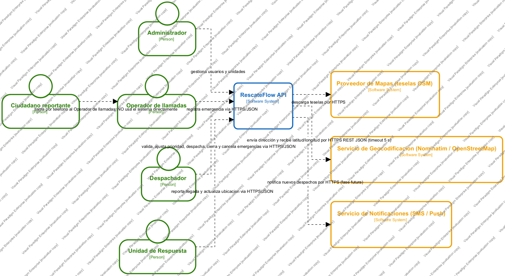
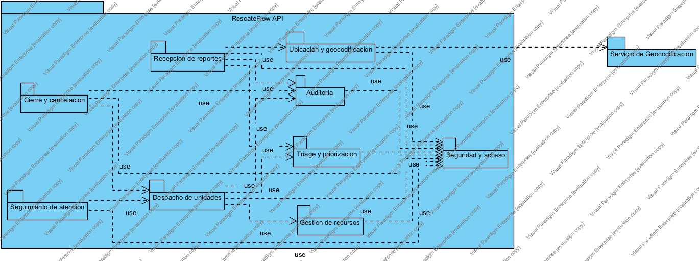
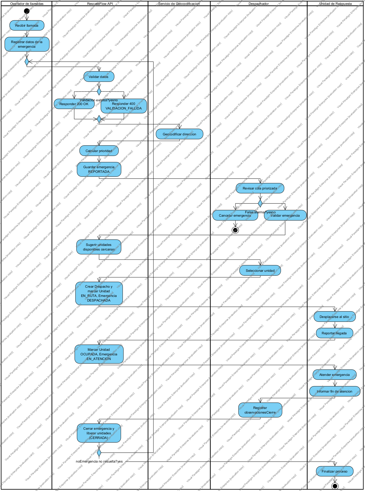
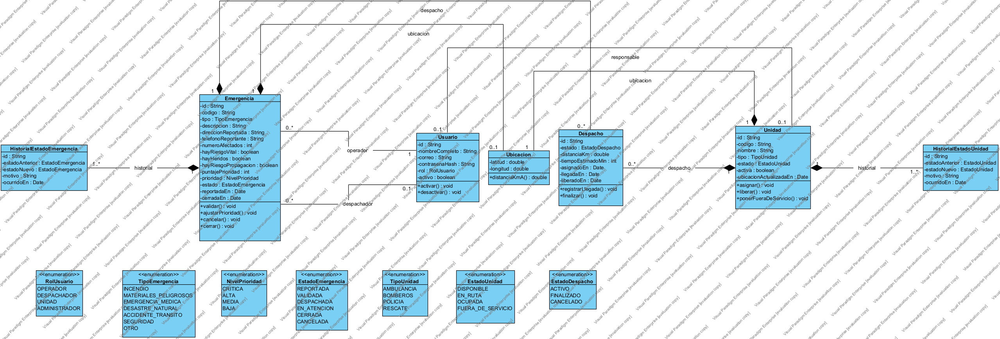
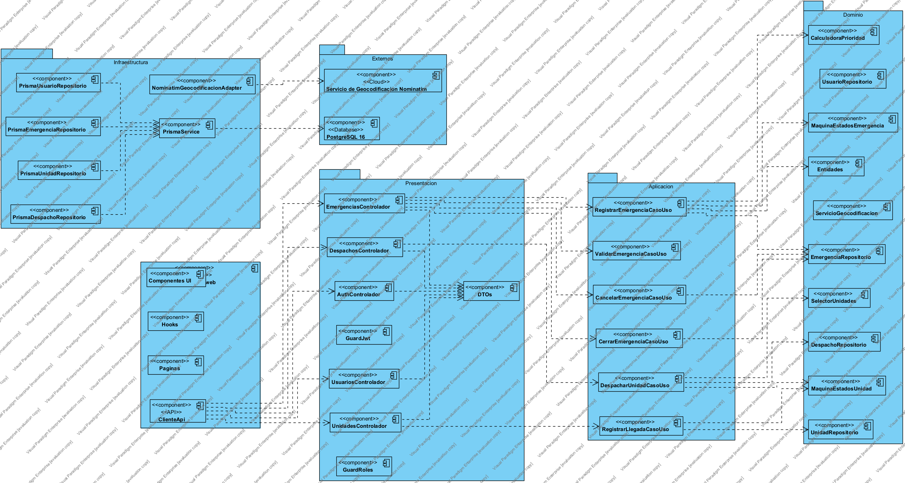
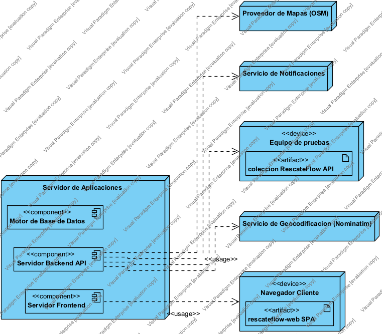

# RescateFlow API

**Sistema de Registro, Priorización y Despacho de Emergencias Urbanas** (caso de referencia: Pasto, Nariño).

RescateFlow centraliza el ciclo de vida de una emergencia: el operador la registra, el sistema calcula su prioridad con reglas de triaje, el despachador asigna la unidad compatible más cercana y cada cambio de estado queda auditado hasta el cierre.

Proyecto académico de Ingeniería de Software, Universidad Cooperativa de Colombia, campus Pasto. Autor: Samuel Moreno.

| Componente | Tecnología | Carpeta |
|---|---|---|
| Backend (API REST) | Node.js, TypeScript, Express 5, SQLite (better-sqlite3), Zod | [`rescateflow-api/`](rescateflow-api/) |
| Frontend (panel operativo) | React 19, Vite, TypeScript | [`rescateflow-web/`](rescateflow-web/) |
| Pruebas de API | Postman (colección v2.1 + entorno), Newman | [`postman/`](postman/) |
| Diagramas de arquitectura | Visual Paradigm 18.1 | [`diagramas/`](diagramas/) |

---

## Puesta en marcha rápida

Requisitos: Node.js 20.19 o superior (recomendado 22 LTS).

```bash
# Terminal 1: backend en http://localhost:3000/api
cd rescateflow-api
npm install
npm run seed        # 4 unidades y 5 emergencias de prueba
npm run dev

# Terminal 2: frontend en http://localhost:5173
cd rescateflow-web
npm install
npm run dev
```

Si el puerto 3000 está ocupado por otro programa, cree `rescateflow-api/.env` con `PUERTO=3001` y `rescateflow-web/.env` con `VITE_BACKEND_URL=http://localhost:3001`.

---

## Reglas de negocio principales

**Prioridad calculada (RN-10 a RN-13).** Puntaje base por tipo (incendio 40, materiales peligrosos 40, emergencia médica 35, desastre natural 35, accidente de tránsito 30, seguridad 25, otro 10) más agravantes: riesgo vital +45, riesgo de propagación +20, heridos +15 y afectados +10/+20/+30. Puntaje de 80 o más: `CRITICA`; 55 o más: `ALTA`; 30 o más: `MEDIA`; menos: `BAJA`. Riesgo vital con 3 o más afectados siempre es `CRITICA`.

**Máquina de estados de una emergencia (RN-30 / RN-31).** Cualquier otra transición responde `409 Conflict`.

```
REPORTADA ──► VALIDADA ──► DESPACHADA ──► EN_ATENCION ──► CERRADA
    │             │             │
    └─────────────┴─────────────┴──► CANCELADA
```

**Disponibilidad de unidades (RN-40 a RN-53).** `DISPONIBLE → EN_RUTA → OCUPADA → DISPONIBLE`. Una unidad solo puede tener un despacho activo, solo se asigna si está `DISPONIBLE` (si no, 409) y debe ser de un tipo compatible con la emergencia (si no, 422): por ejemplo, una ambulancia no atiende un incendio como unidad principal y unos bomberos no atienden una emergencia médica.

---

## Diagramas de arquitectura

Elaborados en Visual Paradigm. El proyecto editable es [`diagramas/RescateFlow_API.vpp`](diagramas/RescateFlow_API.vpp).

### 1. Vista de Contexto (C4 System Context)

El sistema RescateFlow API al centro; el Operador de llamadas, el Despachador, la Unidad de Respuesta y el Administrador lo usan; el Ciudadano reportante solo habla por teléfono con el operador. Se integra con el Servicio de Geocodificación (Nominatim), el Proveedor de Mapas y, como fase futura, un Servicio de Notificaciones.



### 2a. Vista Funcional: módulos

Nueve módulos funcionales (recepción, ubicación, triage, despacho, seguimiento, cierre, gestión de recursos) y dos transversales (seguridad y auditoría), con sus dependencias.



### 2b. Vista Funcional: flujo de atención de una emergencia

Diagrama de actividades con cinco carriles (Operador, RescateFlow API, Geocodificación, Despachador, Unidad de Respuesta) desde la llamada hasta el cierre.



### 3. Vista Lógica: modelo de dominio

Clases `Emergencia`, `Unidad`, `Despacho`, `Usuario`, `HistorialEstadoEmergencia`, `HistorialEstadoUnidad` y el objeto de valor `Ubicacion`, con sus atributos, métodos, relaciones y multiplicidades, y las 7 enumeraciones del dominio.



### 4. Vista de Componentes

Frontend (páginas, componentes, hooks, cliente HTTP) y backend en capas: presentación (controladores, DTOs), aplicación (casos de uso), dominio (entidades, servicios, interfaces de repositorio) e infraestructura (repositorios, adaptador de geocodificación). Las dependencias apuntan hacia el dominio.



### 5. Vista de Despliegue

Navegador cliente, servidor de aplicaciones con frontend, backend y base de datos, servicios externos y equipo de pruebas, con puertos y protocolos.



---

## Backend: endpoints

Base: `http://localhost:3000/api`

| Método | Ruta | Descripción |
|---|---|---|
| GET | `/emergencias?estado=&prioridad=&tipo=` | Lista emergencias ordenadas por prioridad |
| GET | `/emergencias/:id` | Detalle con historial de estados y despachos |
| POST | `/emergencias` | Registra una emergencia (valida, geocodifica y calcula prioridad) |
| PATCH | `/emergencias/:id/estado` | Cambia de estado; 409 si la transición es inválida |
| POST | `/emergencias/:id/asignar-unidad` | Asigna una unidad DISPONIBLE (201) |
| DELETE | `/emergencias/:id` | Solo REPORTADA o CANCELADA; si no, 409 |
| GET | `/emergencias/:id/unidades-sugeridas` | Unidades compatibles y libres ordenadas por distancia |
| GET | `/unidades?estado=&tipo=` | Unidades y su estado actual |
| GET | `/unidades/:id` | Detalle de una unidad con historial |

Todos los errores responden con el mismo formato:

```json
{ "statusCode": 409, "error": "Conflict", "message": "No se puede pasar de REPORTADA a CERRADA...", "timestamp": "2026-11-23T18:40:08.316Z", "codigo": "TRANSICION_INVALIDA" }
```

Más detalle en [`rescateflow-api/README.md`](rescateflow-api/README.md).

## Frontend

Panel operativo en modo oscuro: tarjetas de resumen, formulario de registro con prioridad estimada, filtros por estado y prioridad, tarjetas de emergencia con acciones (asignar unidad, avanzar estado, historial) y panel de unidades. Toda la comunicación con la API pasa por `src/services/apiService.ts`. Más detalle en [`rescateflow-web/README.md`](rescateflow-web/README.md).

## Pruebas

| Tipo | Cómo ejecutar | Resultado |
|---|---|---|
| Unitarias y end-to-end del backend | `cd rescateflow-api && npm test` | 55 pruebas |
| Postman (flujo exitoso, casos negativos y reglas de negocio) | Importar `postman/*.json` en Postman y ejecutar la colección, o `npx newman run postman/RescateFlow.postman_collection.json -e postman/RescateFlow.postman_environment.json` | 30 peticiones, 170 aserciones |

Guía completa de Postman en [`postman/README.md`](postman/README.md).

---

## Arquitectura y principios de diseño

- **Arquitectura en capas** con la regla de dependencia hacia el dominio: las reglas de negocio no conocen Express, SQLite ni HTTP.
- **Patrón Repository**: el dominio define interfaces (`EmergenciaRepositorio`, `UnidadRepositorio`...) y la infraestructura las implementa con SQLite.
- **Patrón Adapter**: `ServicioGeocodificacion` con dos adaptadores intercambiables (`NominatimGeocodificacionAdapter` y `SimuladoGeocodificacionAdapter`).
- **Máquinas de estado por tabla**: todo lo que no está en la tabla de transiciones está prohibido.
- **Transacciones (unidad de trabajo)**: asignar una unidad crea el despacho, cambia la unidad a EN_RUTA, la emergencia a DESPACHADA y registra el historial en una sola operación atómica.
- **Errores de dominio independientes de HTTP**: la capa de presentación los traduce a 400, 404, 409 o 422.

## Estructura del repositorio

```
Rescateflow/
├── rescateflow-api/     backend (dominio, aplicación, infraestructura, presentación, pruebas)
├── rescateflow-web/     frontend React + Vite
├── postman/             colección y entorno de Postman
├── diagramas/           diagramas exportados y proyecto de Visual Paradigm
└── README.md
```
